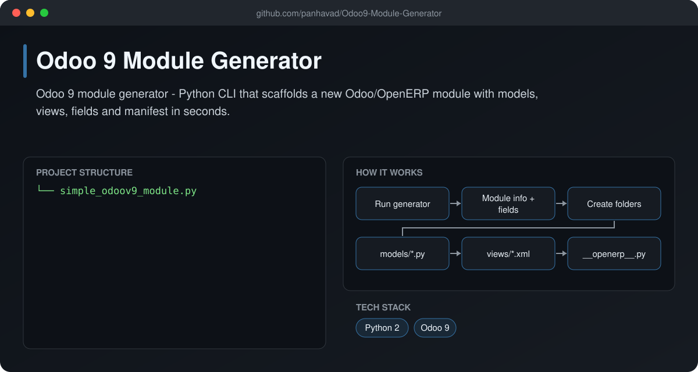
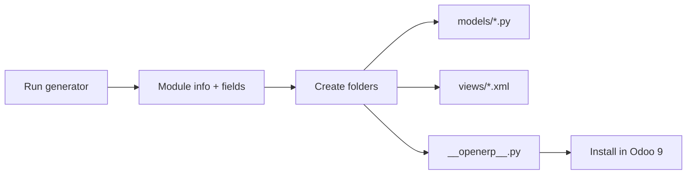

# Odoo 9 Module Generator

  [](https://github.com/panhavad/Odoo9-Module-Generator/releases/latest)

A command-line **scaffolding tool for Odoo 9 (OpenERP) modules**. Answer a few prompts - name, author, category, fields - and it creates the module folder with `__openerp__.py`, models and XML views ready to install.



## Features

- Interactive prompts for module metadata
- Creates `models/` and `views/` folders
- Generates `__init__.py` and `__openerp__.py`
- Adds the fields you define to the model and views

## How it works



## Getting started

```bash
python2 simple_odoov9_module.py
# copy the generated folder to your Odoo addons path
```

## Download

Grab the packaged source from the [latest release](https://github.com/panhavad/Odoo9-Module-Generator/releases/latest).

## Tech stack

- Python 2
- Odoo 9

## Project structure

```text
Odoo9-Module-Generator/
├── docs/
├── README.md
└── simple_odoov9_module.py
```
